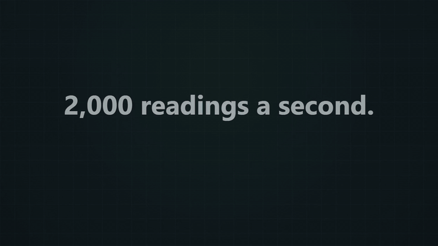
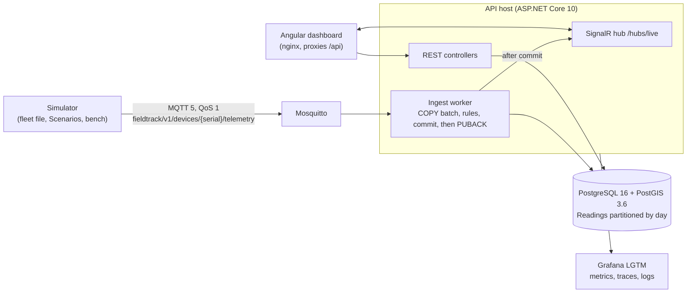

# FieldTrack

Real-time monitoring of field equipment and vehicles. Devices report their position and sensor values over MQTT; the
platform stores every Reading, evaluates Alert Rules (Geofence exit or enter, sensor thresholds with Hysteresis, Offline
Devices) inside the same transaction, and pushes Asset Status and Alerts live to a map dashboard.

[](docs/media/fieldtrack-demo.mp4)

*A 20-second demo recorded from the real dashboard while the demo Scenario runs. Click it for the
[MP4 with sound](docs/media/fieldtrack-demo.mp4). The map tiles are left out of the recording.*

Every Device here is simulated. The simulator also drives the benchmarks behind the numbers on the
[results page](docs/RESULTS.md).

The vocabulary (Asset, Device, Reading, Boot, Coverage gap, ...) is defined in [GLOSSARY.md](GLOSSARY.md); the
decisions behind the design are in [docs/adr](docs/adr). The current spec is
[issue #21](https://github.com/Danie1Le/FieldTrack/issues/21); [docs/SPEC.md](docs/SPEC.md) is the original proposal it
replaced.

## Architecture



- **Ingest** ([ADR 0004](docs/adr/0004-copy-ingest-with-ack-after-commit.md)): batches of up to 1,000 Readings or 25 ms,
  binary COPY into a stage table, one statement that stores the new Readings, rule evaluation, commit, and only then
  the MQTT PUBACKs. A crash before commit means the broker redelivers; a crash after it leaves nothing undone.
- **Reading identity** ([ADR 0001](docs/adr/0001-reading-identity.md)): Device, Boot and Sequence number. A Reading key
  table beside the day-partitioned Readings ([ADR 0003](docs/adr/0003-partitioned-readings-with-key-table.md)) drops
  redelivered copies and counts identical and conflicting duplicates.
- **Rules** ([ADR 0005](docs/adr/0005-rules-evaluated-in-ingest-transaction.md)): a pure Domain evaluator, persisted
  rule state per Alert Rule and Asset, Alerts raised only on a clear-to-breached transition, an Offline sweep every second.
- **Auth** ([ADR 0002](docs/adr/0002-identity-with-own-jwts.md)): ASP.NET Core Identity, JWTs the API signs itself,
  rotating refresh tokens, Admin and Operator roles, a Demo Operator for visitors.

| Folder | What it holds |
|---|---|
| `src/FieldTrack.Domain` | Entities and the rule evaluator, no infrastructure dependencies |
| `src/FieldTrack.Infrastructure` | EF Core context and migrations, the COPY ingest writer, MQTT, CSV export |
| `src/FieldTrack.Api` | REST controllers, SignalR hub, ingest worker, Offline sweep, partition job, auth |
| `src/FieldTrack.Simulator` | Device simulator, `seed`, `demo` and `bench` commands, fleet files and Scenarios |
| `web` | Angular 22 dashboard (Leaflet map, Alert feed, Asset history, Admin screens) |
| `bench` | k6 load test, compose layers for benchmarks, curated results |
| `tests` | Unit tests (Domain, simulator) and integration tests (Testcontainers) |

## Run it locally

Needs Docker (Docker Desktop on Windows or macOS) and, for the simulator, the .NET 10 SDK.

1. Put the secrets in an untracked `.env` file at the repo root (compose reads it):

   ```sh
   FIELDTRACK_AUTH_SIGNING_KEY=<base64 of 32 random bytes, e.g. openssl rand -base64 32>
   FIELDTRACK_ADMIN_EMAIL=admin@example.com
   FIELDTRACK_ADMIN_PASSWORD=<a temporary password, replaced at first sign-in>
   # Optional demo mode: the sign-in page offers this Operator to visitors.
   FIELDTRACK_DEMO_EMAIL=demo@example.com
   FIELDTRACK_DEMO_PASSWORD=<a password>
   ```

2. Start everything:

   ```sh
   docker compose up --build -d
   ```

   | Service | Address |
   |---|---|
   | Dashboard | http://localhost:8081 |
   | API, health, API docs | http://localhost:8080/health, http://localhost:8080/scalar/v1 |
   | Grafana (metrics, traces, logs) | http://localhost:3000 |
   | MQTT broker | localhost:1883 |

   Every port is bound to 127.0.0.1 only. `docker compose down -v` stops the stack and deletes its data.

3. Sign in at http://localhost:8081 as the Admin. The first sign-in asks you to replace the temporary password.

4. Seed the demo fleet and publish telemetry. The simulator signs in with the new password:

   ```sh
   export FIELDTRACK_ADMIN_EMAIL=admin@example.com FIELDTRACK_ADMIN_PASSWORD=<the new password>
   dotnet run --project src/FieldTrack.Simulator -- seed --fleet src/FieldTrack.Simulator/fleets/demo.json
   dotnet run --project src/FieldTrack.Simulator -- run --fleet src/FieldTrack.Simulator/fleets/demo.json --rate 5
   ```

   `dotnet run --project src/FieldTrack.Simulator` with no arguments prints every command and option.

### Tests

```sh
dotnet build                 # warnings are errors
dotnet test                  # unit + integration tests; Docker must be running (Testcontainers)
cd web && npm ci && npx ng test --watch=false
```

CI runs these, an 80% line-coverage gate on the Domain, and a Playwright smoke test against the compose stack on every
pull request.

## Demo script

The demo Scenario ([`fleets/demo-scenario.json`](src/FieldTrack.Simulator/fleets/demo-scenario.json)) shows an Overheat,
a Geofence exit, an Offline Device and a Coverage gap backlog on the dashboard within five minutes. On a stack started as
above, with the Admin's password replaced:

```sh
dotnet run --project src/FieldTrack.Simulator -- demo --fleet src/FieldTrack.Simulator/fleets/demo.json \
  --scenario src/FieldTrack.Simulator/fleets/demo-scenario.json --rate 5 --duration 300
```

`demo` seeds the fleet, adds the Geofence "North yard" and four Alert Rules (two Overheat thresholds, a Geofence exit and an
Offline rule; any that exist are skipped by name), then runs the Scenario: five Devices, one Reading per second each. Open http://localhost:8081 and watch:

| Time | What happens | What the dashboard shows |
|---|---|---|
| ~0:25 | Haul truck 2 drives out of North yard | Geofence exit Alert in the feed; North yard is drawn on the map |
| ~1:50 | Haul truck 1 overheats (engine temperature ramps to 120 °C) | Critical Threshold Alert; the Asset's temperature turns red |
| 1:00-3:30 | Excavator 1 is powered off for 150 s | Last seen counts up; the Asset moves to Offline at 3:00 and back to Normal when it returns on a new Boot |
| 2:00-4:30 | Generator 1 loses coverage for 150 s and overheats meanwhile | Offline Alert at 3:00 (60 s rule). When coverage returns, the backlog arrives: the Offline Alert clears, and the Overheat the Generator suffered while unseen appears in History tagged From backlog, raised and Cleared at the Device times it happened |

Excavator 1 has no Offline rule on purpose: an Active Offline Alert ranks an Asset as Alerting, so only an Asset without
one shows the Offline status.
Run it on a fresh stack (`docker compose down -v` first) for the cleanest feed; the simulator keeps each Device's Boot
in `simulator-state.json` in the working directory.

## Benchmarks

Headline numbers and their raw JSON: [docs/RESULTS.md](docs/RESULTS.md). Every `bench` run writes a JSON file to
`bench/results/` with the metrics and the environment (git SHA, CPU, RAM, OS, Docker limits, Postgres settings, image
tags). A bench refuses a working tree with uncommitted changes, so the SHA identifies the code measured. Exit code 3
means the run finished but missed its bar.

Benchmarks run against a compose stack with the bench layer (commit timestamps on, larger `shared_buffers`, `$SYS`
broker counters every second). Start each from an empty database. The Admin's temporary password in `.env` must be
replaced first: sign in at http://localhost:8081 and set a new one, then export the new password as below.

```sh
docker compose down -v
docker compose -f docker-compose.yml -f bench/docker-compose.bench.yml up --build -d postgres mosquitto api
export FIELDTRACK_ADMIN_EMAIL=... FIELDTRACK_ADMIN_PASSWORD=...
bench() { dotnet run --project src/FieldTrack.Simulator -c Release -- bench "$@" --compose-project fieldtrack; }
```

`--compose-project` is required: it is the compose project name (`docker compose ls`; by default the repo folder's name,
lower-case) and the bench uses it to find the containers it kills and queries. `--api`, `--db` and `--mqtt-port` point
at remapped ports.

| Command | Measures | Bar |
|---|---|---|
| `bench throughput --fleet src/FieldTrack.Simulator/fleets/bench.json` | 2,000 Readings/s for 10 min over 200 Devices: achieved rate, ingest latency (commit time minus publish), broker backlog, loss | rate within 2%, ingest p95 < 200 ms, flat backlog, nothing lost |
| `bench flood --fleet .../bench.json` | Publishes flat out for 60 s; reports what ingest absorbed | reported |
| `bench crash --fleet .../bench.json` | 500 Readings/s for 10 min while `docker kill` hits the API container 10 times | 0 missing, 0 duplicates |
| `bench duplicates --fleet .../bench.json` | 10,000 Readings, then the identical bytes again | stored 10,000, key conflicts 10,000 |
| `bench seed-history --fleet .../bench.json`, then `bench geofence` and `bench history` | 1.08 M Readings over 30 days; Geofence count with and without the GiST index; one Asset's 24 h, partitioned vs not (cold and warm median of 10) | geofence < 50 ms warm with the index; history reported |
| `bench alert-latency --fleet src/FieldTrack.Simulator/fleets/alerts.json` | 200 Threshold breaches, publish to SignalR receive on one clock | p95 < 500 ms |
| `bench offline --fleet .../alerts.json` | Scenario of long and short Power offs and Coverage gaps against a 20 s Offline rule | every long dropout detected within rule + 2 s, 0 false alarms |
| `bench hysteresis --fleet .../alerts.json` | Noisy temperatures against two rules at once, Hysteresis 0 and 8 | fewer false Alerts with Hysteresis; every Fault alerts |

Use a fresh stack (`down -v`) between the telemetry, query and alert groups: insert cost grows with the table, the query
benches need an empty `readings` table, and alert benches leave their rules behind.

**API load test (k6).** 50 Operators for 5 minutes against the dashboard API while the simulator runs at demo rate; bar
p95 < 150 ms and < 0.1% failed. The steps are at the top of [`bench/k6/dashboard.js`](bench/k6/dashboard.js); the stack
uses `bench/docker-compose.k6.yml` and needs the Demo Operator variables set.
