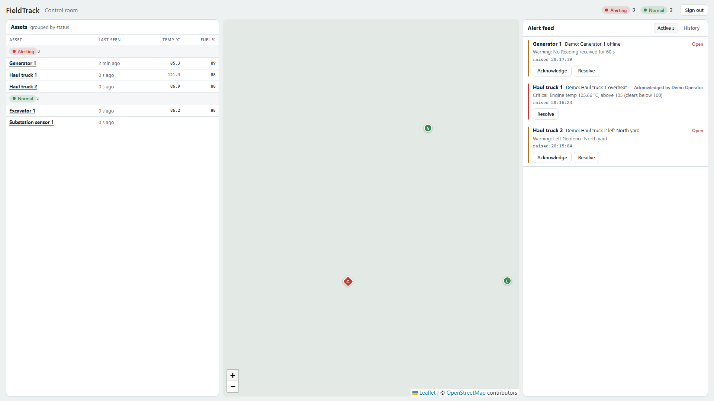
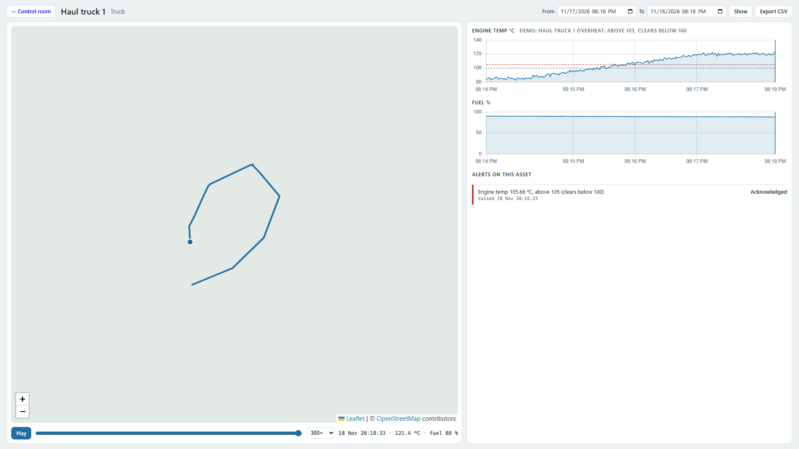

# Running the Azure demo

FieldTrack's cloud demo ran once, on 2026-11-19 (UTC), on an Azure free account. These are the steps to run that
session again, start to finish, and the problems we hit the first time. The measured numbers are in
[RESULTS.md](RESULTS.md#azure-demo). Why the demo is laid out this way is in
[ADR 0006](adr/0006-demo-on-azure-free-account.md).

The two Terraform stacks have their own READMEs, and this page links to them instead of repeating them:

- [`infra/terraform/bootstrap`](../infra/terraform/bootstrap/README.md): the state storage account, the demo resource
  group, the two GitHub identities and the budget. You apply it from your laptop.
- [`infra/terraform/demo`](../infra/terraform/demo/README.md): everything the demo runs (Container Apps, PostgreSQL
  Flexible Server, Key Vault, Application Insights). GitHub Actions applies and destroys it.

A session is one pass through the steps below. Nothing is left running at the end, so the subscription holds no
resources and costs nothing afterwards.

| Step | Where | How long it took |
|---|---|---|
| 1. Check the credit, sign in | Portal, laptop | |
| 2. Apply the bootstrap stack | Laptop | 101 s, 14 resources |
| 3. Set the repository variables and secret | GitHub | |
| 4. Run **Apply demo** | GitHub Actions | 13 min 01 s for the workflow; `terraform apply` 12 min 19 s for 31 resources; the dashboard answered 11 s later |
| 5. Measure and record | Laptop | about 11 min |
| 6. Run **Destroy demo** | GitHub Actions | 23 min 42 s for the destroy step |
| 7. Destroy the bootstrap stack | Laptop | 39 s |
| 8. Delete the variables, check the subscription is empty | GitHub, laptop | |

The times are from the one successful session. The first two Apply attempts failed on the database region, which
[Gotchas](#gotchas) explains.

## Before you start

You need:

- An Azure subscription where you are **Owner**. The bootstrap creates role assignments, which needs Owner. We used a
  free account with $200 of credit and never upgraded it, so it could not charge the card.
- Azure CLI, Terraform 1.17 and, for the benchmark, the .NET 10 SDK. The bootstrap README's
  [Prerequisites](../infra/terraform/bootstrap/README.md#prerequisites) has the install commands and the portal pages
  that show the remaining credit and which billing profile pays for the subscription.
- The images on GHCR. The Images workflow publishes them for every `main` commit whose CI passed. Apply demo checks that
  all four can be pulled anonymously and stops before applying if one cannot.

On a fork, the GitHub identities must trust your repository instead of this one. Set `github_owner_id` and
`github_repository_id` in the bootstrap's `terraform.tfvars` (both are public numbers from `api.github.com`), and change
the owner and repository names in the `github_repo` local in `infra/terraform/bootstrap/main.tf`.

## 1. Check the credit and sign in

Sign in as the subscription owner and confirm the CLI points at the right subscription:

```sh
az login
az account show --query "{name:name, state:state}"
```

Then check in the portal that the credit is there and covers this subscription. Every service in the demo stack is
first-party Azure (no Marketplace), so the credit pays for all of it.

## 2. Apply the bootstrap stack

Follow [Apply once](../infra/terraform/bootstrap/README.md#apply-once): copy `terraform.tfvars.example`, fill in a
globally unique storage account name and the budget email, then `terraform plan` and `terraform apply`. Keep the local
`terraform.tfstate` until the end of the session, because the teardown needs it.

The two things CI cannot check, the conditional RBAC Administrator assignment and the budget, are checked by this
apply. On our free account both were created without errors.

## 3. Set the repository variables and secret

Copy the bootstrap outputs into repository variables and set the `DEMO_ADMIN_EMAIL` secret, as in
[After apply](../infra/terraform/bootstrap/README.md#after-apply). The secret is the first Admin's email. The API sends
no mail, so the address only has to be one nobody else will guess.

## 4. Apply demo

Run **Actions → Apply demo → Run workflow** on `main`. It signs in with OIDC, checks the images, applies the demo stack,
then polls `<dashboard_url>/api/health` until the dashboard, API and database answer. The job summary records the apply
time, the time until the dashboard answered, and the dashboard URL.

Nothing after that is manual. The simulator Container App replaces the Admin's temporary password, seeds the demo fleet
and its Alert Rules, and plays the demo Scenario, so the dashboard shows an Overheat, a Geofence exit and an Offline
Device within five minutes. Visitors sign in with the Demo Operator button on the login page.

Don't change the stack while the session runs. A new revision can briefly run two simulator replicas that publish
different Boots for the same Device, and bumping `secrets_version` would leave the simulator waiting.

## 5. Measure

What we recorded, in the order we did it:

1. Screenshots of the control room and an Asset's detail page, once the Scenario's Alerts were on screen
   ([below](#what-it-looked-like)).
2. Alert latency with `bench alert-latency`, publishing over `wss` from the laptop and listening on the SignalR hub
   through the dashboard's proxy. The bench needs the Admin's and the simulator's broker passwords from Key Vault, which
   needs a Key Vault data role you grant yourself first and remove again before the destroy:

   ```sh
   az role assignment create --role "Key Vault Secrets User" --assignee <your user> \
     --scope "$(az keyvault show -n <key_vault_name> --query id -o tsv)"
   ```

   Measure how far your clock is from NTP just before the run (on Windows,
   `w32tm /stripchart /computer:time.windows.com /samples:5`). Then run:

   ```sh
   export FIELDTRACK_ADMIN_EMAIL=<the DEMO_ADMIN_EMAIL value>
   export FIELDTRACK_ADMIN_PASSWORD="$(az keyvault secret show --vault-name <key_vault_name> -n admin-password --query value -o tsv)"
   export FIELDTRACK_MQTT_PASSWORD="$(az keyvault secret show --vault-name <key_vault_name> -n mqtt-simulator-password --query value -o tsv)"
   dotnet run --project src/FieldTrack.Simulator -c Release -- bench alert-latency \
     --fleet src/FieldTrack.Simulator/fleets/alerts.json \
     --api <dashboard_url>/api \
     --mqtt-transport wss --mqtt-host <host of mqtt_url> --mqtt-username simulator \
     --clock-offset-ms <ms this machine's clock is behind NTP>
   ```

   `dashboard_url`, `mqtt_url` and `key_vault_name` are outputs of the demo stack, also in the Apply demo summary.
   The total latency is measured on the laptop's clock alone, so it is exact. The server and push split assumes the Azure
   hosts keep NTP time; that is what `--clock-offset-ms` is for, because the laptop cannot reach the database to measure
   the offset there. A `--api` that is not on this machine makes the bench treat the platform as remote: it records only
   the laptop in `environment` and needs no `--compose-project` or `--db`. The run leaves 10 Assets (Alert bench
   001-010), their Threshold rules, 200 resolved Alerts and a bench Operator in the demo.
3. Per-visitor sign-in rate limiting. Behind Container Apps ingress and nginx, the API must still see each visitor's
   own address, or every visitor shares one rate-limit partition. Send 12 sign-ins with an email no account has, so no
   real account's lockout count moves. The limit is 10 a minute per address, so the last two get 429:

   ```sh
   U=<dashboard_url>/api/auth/sign-in
   for i in $(seq 1 12); do curl -s -o /dev/null -w "%{http_code} " -H "Content-Type: application/json" \
     --data '{"email":"rate-limit-probe@example.invalid","password":"not-a-real-password"}' $U; done
   ```

   Then, within the same minute, sign in from a second address. We used the environment's own outbound address, with
   `az containerapp exec -n fieldtrack-dashboard -g rg-fieldtrack-demo` and `wget` to the public URL. If that request is
   not answered with 429, it landed in its own partition and the forwarded headers work.
4. A 31-day CSV export of every Asset through the dashboard proxy and the API's ingress, timing the export ticket,
   the first byte and the full download.
5. Remove your Key Vault role assignment (`az role assignment delete` with the same arguments). The demo stack does
   not own it, so its destroy would leave it behind.

## 6. Destroy demo

Run **Actions → Destroy demo → Run workflow** on `main`. It destroys the stack, purges the Key Vault, deletes the
"Application Insights Smart Detection" action group that Azure adds outside Terraform, and fails with a list if anything
else is left in `rg-fieldtrack-demo`. The demo README's [Destroy](../infra/terraform/demo/README.md#destroy) section
covers what to do when it fails, and how Apply and Destroy share the state lock.

## 7. Destroy the bootstrap stack

Follow [Tear down](../infra/terraform/bootstrap/README.md#tear-down-end-of-the-session) from the same folder and the same
local state. It refuses to delete a resource group that still has resources in it, so a leftover from step 6 stops it
instead of being removed unseen.

## 8. Clean up GitHub and check the subscription is empty

Delete the repository variables and the `DEMO_ADMIN_EMAIL` secret, so the pull-request plan jobs skip instead of failing
to sign in as identities that no longer exist. Then:

```sh
az group list --output table
az consumption budget list --output table
```

Both came back empty after our session.

## What it cost

Cost Management had no data for the session when we checked: `az consumption usage list` and the Cost Management query
API returned no rows for any resource group. Its data lags by 8 to 24 hours, and data for earlier deploys that month
did not show either, which may be because the subscription runs on credit. To check after a session, open
**Cost Management → Cost analysis** a day later, scope it to the subscription, and group by resource group; the credit
balance is under **Billing profile → Benefits → Azure credits**.

The only number we have is an estimate from the Azure Retail Prices API (northcentralus, pay-as-you-go, before the
Container Apps monthly free grant):

| Item | Per hour |
|---|---|
| PostgreSQL Flexible Server B1ms compute | $0.017 |
| Container Apps, 1.25 vCPU across the four apps | $0.108 |
| Container Apps, 2.5 GiB memory | $0.027 |
| Postgres storage, Log Analytics and Application Insights ingestion | small, not priced |

That is about $0.15 an hour, or about $3.60 a day if left running. The Container Apps free grant (180,000 vCPU-seconds
and 360,000 GiB-seconds a month) covers about 40 hours of these four apps. Our successful stack existed for under an
hour, from the start of Apply demo at 04:01 UTC to the end of the teardown at 04:53 UTC. The account was never
upgraded, so whatever the session cost came out of the credit.

## What it looked like

The control room on the Azure address during the session, with the Scenario's three Alerts active. The map tiles were
blocked while taking the screenshots, so the map has no background.



Haul truck 1's detail page: its route, the engine temperature crossing the 105 °C threshold, fuel, and its Alert.



## Gotchas

Each of these happened during the session or in the days before it.

### Free accounts can't create Flexible Server in most US regions

The first Apply, in westus2, failed after about 12 minutes with `ParameterOutOfRange: The value of the 'Version' should
be in: []`: the free account is offered no server versions there. The second, in westus3, failed with `SkuNotAvailable`,
although `az postgres flexible-server list-skus` listed B1ms there. The list is not proof for a free account; only a
real create is. We then created throwaway servers in a throwaway resource group to probe regions, and only
northcentralus and canadacentral reached Ready with B1ms. The demo stack now defaults to northcentralus. The demo
README's [Region](../infra/terraform/demo/README.md#region) section lists what each region returned. Each failed Apply
left a partial stack, so run Destroy demo after a failed Apply before trying again.

### The GitHub OIDC subject uses the immutable format

GitHub's OIDC subject for this repository embeds the numeric owner and repository ids
(`repo:<owner>@<owner id>/<repo>@<repo id>:ref:refs/heads/main`). Federated credentials written with the plain
`repo:<owner>/<repo>` subject fail sign-in with `AADSTS700213`. We found this on the first pull-request plan after the
bootstrap apply, fixed the subjects, and re-applied the bootstrap; the two credentials were updated in place. The
bootstrap README's [Who can sign in](../infra/terraform/bootstrap/README.md#who-can-sign-in) section has the subjects.

### Git Bash rewrites Azure resource ids on Windows

An argument that starts with `/subscriptions/...` looks like a Unix path to Git Bash, which turns it into a Windows path
before `az` sees it. We hit this deleting the leftover action group by id from the laptop; deleting it by name worked.
Prefix the command with `MSYS_NO_PATHCONV=1`, or use names or PowerShell. The workflows run on Linux, so only commands
you run locally are affected.

### The first Destroy left an action group behind

The id of the "Application Insights Smart Detection" action group has spaces in it, and the cleanup step split the
unquoted list of ids on them. The step quotes them now (#177).

### `az login` on Windows can pick the wrong account

The Windows sign-in broker picked a personal Microsoft account instead of the subscription owner's. Turning the broker
off fixed it: `az config set core.enable_broker_on_windows=false`, then `az login` again.

## Not checked in the cloud

- The PostGIS extension version on Flexible Server. The server allows only Azure addresses, and the session did not
  read the database password, so we ran no SQL. The API migrates before it listens and it started healthy, and the
  Geofence Alert was raised in the cloud, so PostGIS was installed and working.
- Whether a full 31-day CSV export fits in Container Apps ingress's 240 s request timeout. The stack was minutes old,
  so each export held at most 633 Readings.
- Whether the Reading key index stays cached in B1ms's memory at demo volume, for the same reason.
